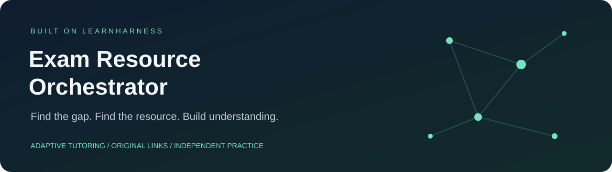
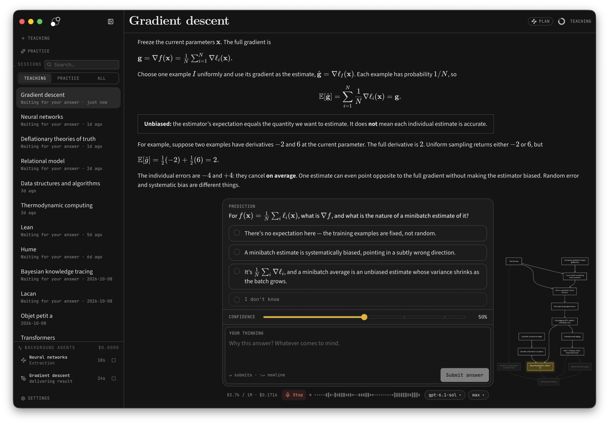
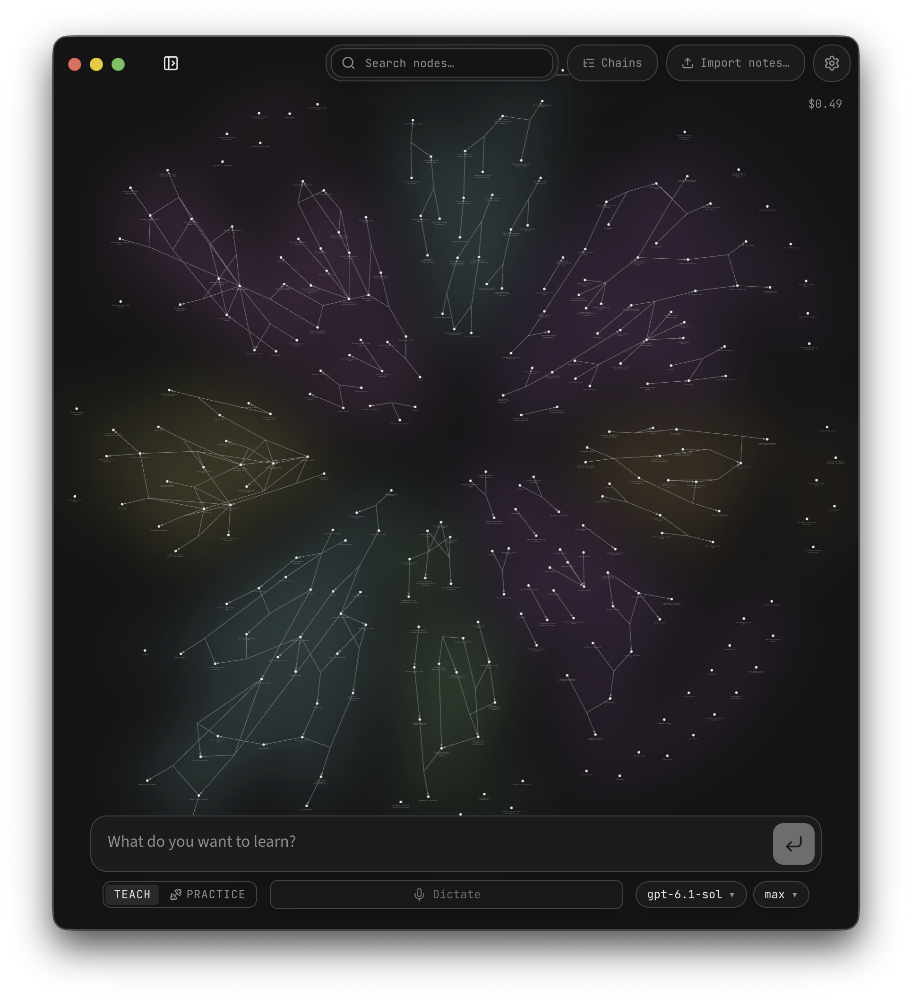

<p align="center">
  
</p>

<p align="center"><strong>A tutor that helps you understand what to study next — and where to find it.</strong></p>

<p align="center">
  <a href="#get-started">Get started</a> ·
  <a href="#the-learning-loop">How it works</a> ·
  <a href="#a-library-of-links-not-a-content-dump">Resource catalog</a> ·
  <a href="docs/README.md">Documentation</a> ·
  <a href="https://github.com/ahammadshibil/exam-resource-orchestrator/issues">Issues</a>
</p>

<p align="center">
  <a href="https://github.com/ahammadshibil/exam-resource-orchestrator/actions/workflows/learnharness-integration.yml"></a>
  <a href="LICENSE"></a>
  
  
</p>

You know the topic you want to learn. The harder questions are **what you are missing, which resource will help, and whether you understood it afterward**.

Exam Resource Orchestrator connects [LearnHarness](https://github.com/amosblomqvist/learnharness)'s adaptive teaching and practice agents to a catalog of **15,471 learning references**. Start with your current understanding, work through a lesson, follow an original source when useful, and come back to try a fresh problem.

## See the teaching experience



*Upstream LearnHarness screenshot, included with the imported application. It shows the inherited teaching interface; it is not a screenshot of our resource-tool output. Screenshots may differ from your model and local setup.*

The lesson asks you to predict, explain your reasoning and check your understanding. Our integration makes resource discovery available during probing, teaching and practice, alongside those existing interactions.

## The learning loop

| Step | What happens |
| --- | --- |
| **01 · Find the gap** | Start with a question. The tutor uses your answers and reasoning to establish where to begin. |
| **02 · Build understanding** | Work through an adaptive lesson and its dependency plan. |
| **03 · Open a useful source** | The resource tool searches metadata and returns original links, access caveats and an active-study task. |
| **04 · Try it independently** | Return for a fresh problem or explanation in your own words. A click or completed reading does not establish mastery. |

Try this as your first message:

> Help me understand torque. Diagnose my difficulty first, suggest one useful external resource, and test me after I study it.

## A library of links, not a content dump

The bundled catalog works without a search API key. It keeps references to material at its original source, so you can visit the publisher or creator directly.

| Source | Bundled references | What you get |
| --- | ---: | --- |
| **OpenStax** | 4,790 | Section locators from publisher sitemaps |
| **NPTEL** | 3,483 | Courses from the official catalog |
| **MIT OpenCourseWare** | 744 | Course and section locators |
| **HackerTube** | 6,454 | Video reference metadata linking to original YouTube videos |
| **NCERT · DIKSHA · SWAYAM · NTA** | Manual discovery | Official catalog and examination starting points |

**No lesson, video or transcript downloads are needed for this tool.** Unknown copying permission can retain the original link with a warning. Login, cost, region and availability restrictions are shown when known. Optional live discovery uses your configured search provider.

Counts describe bundled snapshots, not live coverage. Sitemap labels may be derived from URLs; references are candidates rather than verified lesson or exam mappings. See [source provenance](docs/INDEX_SOURCES.md) and [metadata attribution](THIRD_PARTY_NOTICES.md).

## Knowledge that carries forward



*Upstream LearnHarness screenshot of the inherited knowledge-graph interface.*

LearnHarness stores propositions and reasoning chains with links to their source sessions. Later teaching and practice can use those connections. The graph represents ideas and their relationships; it does not rate your ability.

The standalone Python engine separately records reviewed assessments and intervention history in SQLite. These two stores are not synchronized.

## Get started

Choose the **tutoring app** for the conversational interface, or the **Python CLI** for reference search and reviewed assessment workflows. You can use either independently.

### Tutoring app

Install Git, **Node.js 26** and npm. Then:

```sh
git clone https://github.com/ahammadshibil/exam-resource-orchestrator.git
cd exam-resource-orchestrator/learnharness
npm ci
npm run dev -- --hostname 127.0.0.1
```

Open <http://127.0.0.1:3000>. Configure a model provider in the app's settings and start a lesson. Model access may require your own account, API key and payment depending on the provider. No credentials are included. Searching the bundled catalog needs no search key; conversational tutoring needs a configured model.

Try:

> Help me understand torque. Diagnose my difficulty first, suggest one useful external resource, and test me after I study it.

Optional live discovery uses the app's configured search provider when requested by the resource tool. It sends the topic query externally; the bundled metadata search works locally. See [integration details](learnharness/UPSTREAM_INTEGRATION.md) for configuration, data boundaries and packaging.

### Python CLI

Requires **Python 3.11+**, with no runtime dependencies. Run from the repository root:

```sh
python -m exam_resources sources
python -m exam_resources references "linear algebra" --provider nptel
python -m exam_resources references "photosynthesis" --provider openstax
python -m exam_resources --db demo.sqlite3 diagnostic torque
python -m exam_resources --db demo.sqlite3 recommend examples/torque.json
```

The example diagnostic is synthetic. Use real diagnostic responses before making learner-specific decisions. The reviewed assessment workflows cover torque, cell division and hypothesis-test selection; arbitrary-topic referrals use general study prompts and cannot update mastery. See the [Python guide](docs/PYTHON_GUIDE.md) for diagnostics, assessment, storage, live search and API examples.

## Your models, your data

- **Bring your model connection.** Provider billing depends on your account and configuration. No API keys or accounts are supplied by this project.
- **Local records, configured services.** LearnHarness stores learning records and settings locally. Model requests use the context needed for the task; search and dictation can also contact external providers. Local storage does not imply offline processing.
- **Metadata for referrals.** The resource tool searches titles, tags and locators. Other inherited research and file tools retain their own behavior.
- **Inspectable code and prompts.** The application and integration are open source under AGPL-3.0-only.

## Explore the documentation

| I want to… | Read this |
| --- | --- |
| Configure models and start a session | [Getting started](learnharness/docs/getting-started.md) |
| Use a custom or local model endpoint | [Custom providers](learnharness/docs/custom-providers.md) |
| Understand what this integration adds | [Integration guide](learnharness/UPSTREAM_INTEGRATION.md) |
| Use diagnostics, assessments and the Python API | [Python guide](docs/PYTHON_GUIDE.md) |
| Understand reference provenance | [Index sources](docs/INDEX_SOURCES.md) |
| Explore architecture and upstream features | [LearnHarness documentation](learnharness/docs/README.md) |
| Make a change | [Contributing](CONTRIBUTING.md) |

## Coverage and limitations

This is an experimental integration, not a complete exam platform or a validated measure of educational effectiveness. It does not implement an absent Exam Reverse Engineer Modules 1–15 codebase.

Catalog search is lexical. References are discovery candidates, not guaranteed curriculum matches. OpenStax and MIT sitemap labels are derived from URLs and have not been verified against page headings. Availability, language, price, regional access and instructional accuracy can be unknown. Manual discovery routes are catalog starting points, not specific lesson matches.

Catalog counts describe the bundled snapshots, not continuously updated coverage. See [index sources](docs/INDEX_SOURCES.md) and [third-party notices](THIRD_PARTY_NOTICES.md). Desktop sources are included, but this integration does not publish a signed installer or claim validation of a real model-driven teaching session.

## Development

```sh
# Repository root
python -m unittest discover -s tests -v

# App (Linux / Node 26 is the CI environment)
cd learnharness
npm ci
npm run typecheck
npm test
npm run lint
npm run build
node scripts/smoke-provider-runtime.mjs
node scripts/build-server.mjs
node scripts/smoke-server.mjs
```

Some upstream tests rely on Unix permissions and process signals. Use the Linux CI environment for the complete app suite. After changing the Python catalog snapshots, run `node scripts/sync-learning-catalog.mjs` from `learnharness/`; tests verify that the app copies match.

## Repository map

| Path | Purpose |
| --- | --- |
| `learnharness/` | Full upstream tutoring app plus the resource-tool integration |
| `exam_resources/` | Standalone Python engine, CLI and metadata |
| `examples/` | Synthetic inputs and integration examples |
| `tests/` | Python tests; app tests live in `learnharness/tests/` |
| `docs/` | Source provenance, Python guide and integration verification |

## Contributing

Read [CONTRIBUTING.md](CONTRIBUTING.md) before opening a pull request. Report reproducible bugs through [GitHub Issues](https://github.com/ahammadshibil/exam-resource-orchestrator/issues). Never include API keys, learner files or private progress databases in an issue or commit.

## License and attribution

Project code is licensed under **GNU AGPL v3.0 only**; see [LICENSE](LICENSE). LearnHarness is by its upstream contributors, imported from v0.5.0 at commit `da08cb5f7d098598ba963c6689b22054c9f2a5a3`. Its original license and notices remain in `learnharness/`. This project is an independent derivative and implies no upstream endorsement.

Catalog metadata and external teaching material have separate rights. HackerTube's included reduced database carries ODC-By attribution requirements. The project license does not license linked videos, books or courses. Preserve [THIRD_PARTY_NOTICES.md](THIRD_PARTY_NOTICES.md) when redistributing the catalogs.
