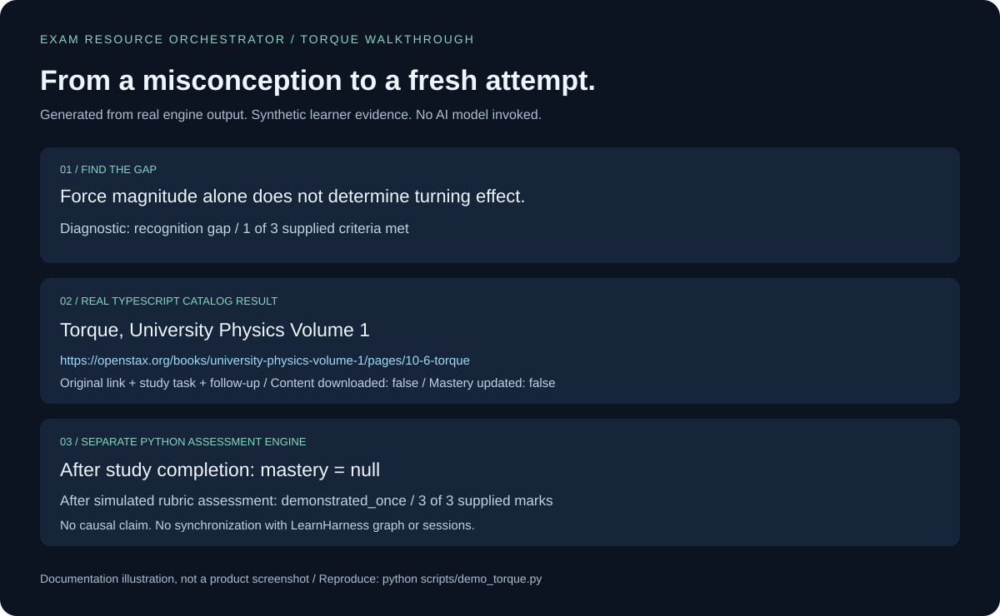

# Torque: a reproducible walkthrough

This walkthrough has two tracks. The key-free demo runs real resource-discovery and assessment code with synthetic evidence. The model-driven track shows how to try the conversational app yourself; it is not claimed as a recorded or validated live session.

## Run the key-free demo

Install Python 3.11+, Node 26 and the app dependencies:

```sh
git clone https://github.com/ahammadshibil/exam-resource-orchestrator.git
cd exam-resource-orchestrator
cd learnharness
npm ci
cd ..
python scripts/demo_torque.py
```

Expected terminal output starts with:

```text
PASS: real TypeScript catalog result; completion leaves mastery null; simulated assessment records demonstrated_once; no causal attribution.
```

Open `docs/demo/index.html` in your browser. It is a self-contained, three-step documentation demo with no external scripts or model calls. Select **Find the gap**, **Find a source**, and **Check fresh work**. The assessment answer starts collapsed. The same run writes [raw JSON](demo/torque.json) and the [result illustration](assets/torque-demo-results.svg).



This is a generated illustration, not a screenshot of the tutoring application. The runnable HTML is a documentation viewer, not a new product screen.

## What the demo actually checks

| Stage | Input and observed result |
| --- | --- |
| Diagnostic | A synthetic learner says a larger force must turn more even through the pivot. Supplied marks `[false, false, true]` produce a recognition gap. |
| Native app resource adapter | `query: torque`, `providers: [openstax]`, `limit: 1` returns the OpenStax University Physics torque section, with its original URL, study activity, access note and follow-up. |
| Referral boundary | The tool reports `contentDownloaded: false` and `masteryUpdated: false`. It does not open or validate the remote page. |
| Study completion | The Python engine records completion; stored mastery remains `null`. |
| Assessment | A fixture supplies the assigned follow-up's reference answer and three passing rubric marks. The Python engine records `demonstrated_once`, with no causal attribution. |

**This does not show a real learner improving.** Diagnostic and assessment marks are supplied by the fixture, not automatically graded. The demo simulates an independent attempt; it does not establish that an actual person worked independently. It uses an in-memory database and never reads existing learner records. The TypeScript catalog and Python assessment engine run separately, reflecting their actual integration boundary.

## Try a real conversational session

1. From `learnharness/`, run `npm run dev -- --hostname 127.0.0.1` and open <http://127.0.0.1:3000>.
2. Open Settings and configure a supported model provider and model. Follow [Getting started](../learnharness/docs/getting-started.md) or [Custom providers](../learnharness/docs/custom-providers.md). Confirm that your connection works before starting the session. Model costs depend on your provider.
3. Start a teaching session with this request:

   > Help me understand torque. Diagnose my difficulty first. Ask me to predict the effect of a radial versus perpendicular force, then suggest one original OpenStax resource with the learning_resources tool. After I study it, give me a fresh problem without showing its answer.

4. Give your actual reasoning. Do not copy the synthetic response above. The agent should use it to identify the difficulty before prescribing material.
5. When it recommends a resource, inspect the original URL and access notes. The bundled torque example points to [OpenStax section 10.6](https://openstax.org/books/university-physics-volume-1/pages/10-6-torque). Opening it is your action; the resource tool does not fetch its teaching content.
6. Study the relevant section and complete the suggested activity. Return, close the source and answer the new question unaided. Ask for feedback on both the result and the moment-arm reasoning.

Exact dialogue, tool choice and follow-up depend on the configured model. If no link appears, ask explicitly to call `learning_resources` for `torque`, provider `openstax`, limit `1`, with live search off. For a deterministic catalog check independent of model behavior, use the key-free demo.

## Acceptance checklist for a live recording

- The learner's reasoning appears before the recommendation.
- The agent calls the real resource tool and displays its returned original link.
- Access/verification caveats remain visible.
- The learner returns after studying and receives a different problem.
- No click or completion is described as proof of mastery.
- Any published recording contains only consenting/synthetic learner data and no provider keys.

A live session has not been captured in this checkout because no model is configured. Browser screenshot capture also could not access the local documentation preview. The repository therefore labels its generated visual and inherited screenshots explicitly. This checklist describes what a future live recording must demonstrate, not a completed validation claim.

## Troubleshooting

| Symptom | Action |
| --- | --- |
| Demo asks for app dependencies | Run `npm ci` inside `learnharness/`, then run the Python script from the repository root. |
| `node` or `python` not found | Install the documented runtimes and open a fresh terminal. |
| No model available in the app | Configure a provider and select a model in Settings; catalog search does not configure a tutor. |
| A source will not open | Read the access note and choose an alternative original source; a bundled URL does not guarantee current availability. |
| Python assessment does not appear in the graph | These stores are separate; no automatic synchronization is implemented. |
